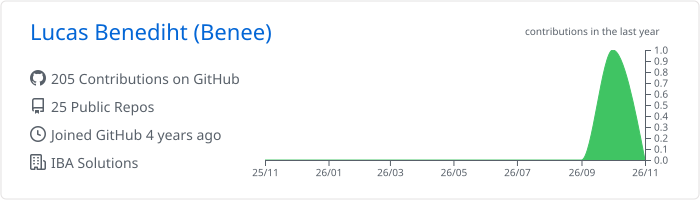

<div align="center">

# Lucas Benediht <sub>*(Benee)*</sub>

<picture>
  <source media="(prefers-color-scheme: dark)" srcset="https://readme-typing-svg.demolab.com?font=Fira+Code&weight=500&size=16&duration=3200&pause=1200&color=58A6FF&center=true&vCenter=true&width=640&height=34&lines=Software+Engineer+%C2%B7+Back-end+(.NET+%26+Angular);RPA+Developer+%C2%B7+A360%2C+Power+Automate+%26+Python;Building+scalable+APIs+%26+enterprise+automations" />
  <source media="(prefers-color-scheme: light)" srcset="https://readme-typing-svg.demolab.com?font=Fira+Code&weight=500&size=16&duration=3200&pause=1200&color=0969DA&center=true&vCenter=true&width=640&height=34&lines=Software+Engineer+%C2%B7+Back-end+(.NET+%26+Angular);RPA+Developer+%C2%B7+A360%2C+Power+Automate+%26+Python;Building+scalable+APIs+%26+enterprise+automations" />
  
</picture>

Londrina, Brazil · Software Developer Analyst at **Tata Consultancy Services (TCS)**

<br />

<a href="https://www.linkedin.com/in/lucas-benediht-caldeira-616a73139/" target="_blank">
  
</a>
<a href="mailto:lucas_benediht@hotmail.com">
  
</a>
<a href="https://www.instagram.com/lucasbenediht/" target="_blank">
  
</a>

</div>

---

### About Me

Hi! I'm **Lucas Benediht** — most people online know me as **Benee**. I'm a Software Developer based in Londrina, Brazil, currently at **TCS**, where I work across both **Back-end (.NET / C# & Angular)** and **RPA** (Automation Anywhere A360, Power Automate, and Python). I enjoy turning complex workflows and legacy challenges into clean, reliable software.

```csharp
public sealed class LucasBenediht // online as Benee
{
    public string Role => "Software Developer Analyst @ TCS";
    public string[] CoreFocus => [".NET / C#", "Angular", "RPA (A360 · Power Automate · Python)"];
    public string[] EnterpriseClients => ["Petrobras (E&P)", "Itaú"];
    public string[] Highlights => ["50+ bots migrated with AI", "10k+ high-volume workflows", "Control Room Admin"];
}
```

---

### Certifications

| Certification | Issuer |
| :--- | :--- |
| **Master RPA Professional** | Automation Anywhere |
| **Advanced RPA Professional** | Automation Anywhere |
| **PL-500: Power Automate RPA Developer** | Microsoft |
| **Foundational C#** | Microsoft |

---

### Tech Stack

<div align="center">

<picture>
  <source media="(prefers-color-scheme: dark)" srcset="https://skillicons.dev/icons?i=cs,dotnet,py,angular,ts,js,react,django,flask,java,postgres,mysql,mongodb,sqlite,docker,githubactions,jenkins,gitlab,git,azure&perline=10&theme=dark" />
  <source media="(prefers-color-scheme: light)" srcset="https://skillicons.dev/icons?i=cs,dotnet,py,angular,ts,js,react,django,flask,java,postgres,mysql,mongodb,sqlite,docker,githubactions,jenkins,gitlab,git,azure&perline=10&theme=light" />
  
</picture>

<br /><br />

<sub>**RPA & Enterprise Tools**</sub>


</div>

---

### Contributions & Activity

<div align="center">

<picture>
  <source media="(prefers-color-scheme: dark)" srcset="https://github-readme-stats.vercel.app/api?username=Lucas-Benediht&show_icons=true&count_private=true&theme=github_dark&hide_border=true&bg_color=0D1117&title_color=58A6FF&icon_color=58A6FF" />
  <source media="(prefers-color-scheme: light)" srcset="https://github-readme-stats.vercel.app/api?username=Lucas-Benediht&show_icons=true&count_private=true&theme=default&hide_border=true&bg_color=FFFFFF&title_color=0969DA&icon_color=0969DA" />
  
</picture>
<picture>
  <source media="(prefers-color-scheme: dark)" srcset="https://streak-stats.demolab.com/?user=Lucas-Benediht&theme=github-dark-blue&hide_border=true&background=0D1117" />
  <source media="(prefers-color-scheme: light)" srcset="https://streak-stats.demolab.com/?user=Lucas-Benediht&theme=default&hide_border=true&background=FFFFFF&ring=0969DA&fire=0969DA&currStreakLabel=0969DA" />
  
</picture>

<br /><br />

<picture>
  <source media="(prefers-color-scheme: dark)" srcset="./profile-summary-card-output/github_dark/0-profile-details.svg" />
  <source media="(prefers-color-scheme: light)" srcset="./profile-summary-card-output/github/0-profile-details.svg" />
  
</picture>

<br /><br />

<picture>
  <source media="(prefers-color-scheme: dark)" srcset="https://github-readme-activity-graph.vercel.app/graph?username=Lucas-Benediht&theme=github-dark&bg_color=0D1117&color=C9D1D9&line=58A6FF&point=79C0FF&area=true&hide_border=true&radius=8" />
  <source media="(prefers-color-scheme: light)" srcset="https://github-readme-activity-graph.vercel.app/graph?username=Lucas-Benediht&theme=github-compact&bg_color=FFFFFF&color=24292F&line=0969DA&point=0969DA&area=true&hide_border=true&radius=8" />
  
</picture>

</div>
