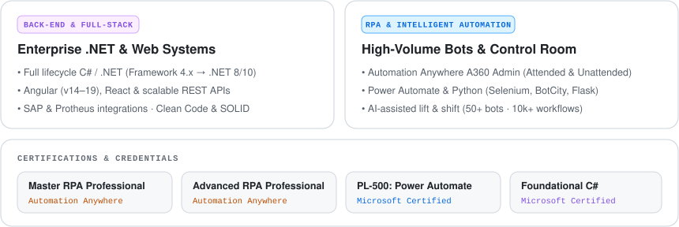
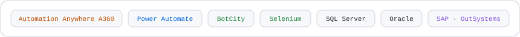
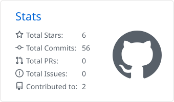
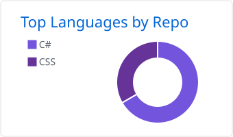

<!-- Adaptive Custom Hero Card -->
<picture>
  <source media="(prefers-color-scheme: dark)" srcset="./assets/hero-dark.svg" />
  <source media="(prefers-color-scheme: light)" srcset="./assets/hero-light.svg" />
  
</picture>

  

<!-- Clean Contact Dock -->

&nbsp;

&nbsp;

  

<!-- Adaptive Bento Grid: Engineering Focus & Certifications -->
<picture>
  <source media="(prefers-color-scheme: dark)" srcset="./assets/bento-focus-dark.svg" />
  <source media="(prefers-color-scheme: light)" srcset="./assets/bento-focus-light.svg" />
  
</picture>

  

<!-- Tech Stack Dock (Adaptive Skill Icons + Enterprise/RPA Strip) -->
<picture>
  <source media="(prefers-color-scheme: dark)" srcset="https://skillicons.dev/icons?i=cs,dotnet,py,angular,ts,react,django,flask,java,postgres,mysql,mongodb,sqlite,docker,githubactions,jenkins,gitlab,git,azure&perline=10&theme=dark" />
  <source media="(prefers-color-scheme: light)" srcset="https://skillicons.dev/icons?i=cs,dotnet,py,angular,ts,react,django,flask,java,postgres,mysql,mongodb,sqlite,docker,githubactions,jenkins,gitlab,git,azure&perline=10&theme=light" />
  
</picture>

  

<picture>
  <source media="(prefers-color-scheme: dark)" srcset="./assets/rpa-stack-dark.svg" />
  <source media="(prefers-color-scheme: light)" srcset="./assets/rpa-stack-light.svg" />
  
</picture>

  

<!-- Adaptive Monthly Commits & Analytics (Auto-updated daily via GitHub Actions) -->
<picture>
  <source media="(prefers-color-scheme: dark)" srcset="./profile-summary-card-output/github_dark/0-profile-details.svg" />
  <source media="(prefers-color-scheme: light)" srcset="./profile-summary-card-output/github/0-profile-details.svg" />
  
</picture>

 

<picture>
  <source media="(prefers-color-scheme: dark)" srcset="./profile-summary-card-output/github_dark/3-stats.svg" />
  <source media="(prefers-color-scheme: light)" srcset="./profile-summary-card-output/github/3-stats.svg" />
  
</picture>
<picture>
  <source media="(prefers-color-scheme: dark)" srcset="./profile-summary-card-output/github_dark/4-productive-time.svg" />
  <source media="(prefers-color-scheme: light)" srcset="./profile-summary-card-output/github/4-productive-time.svg" />
  
</picture>

<picture>
  <source media="(prefers-color-scheme: dark)" srcset="./profile-summary-card-output/github_dark/1-repos-per-language.svg" />
  <source media="(prefers-color-scheme: light)" srcset="./profile-summary-card-output/github/1-repos-per-language.svg" />
  
</picture>
<picture>
  <source media="(prefers-color-scheme: dark)" srcset="./profile-summary-card-output/github_dark/2-most-commit-language.svg" />
  <source media="(prefers-color-scheme: light)" srcset="./profile-summary-card-output/github/2-most-commit-language.svg" />
  
</picture>

  

Built for clean architecture, resilient automations, and measurable impact.

