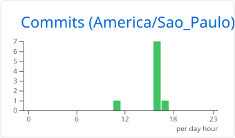
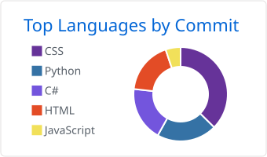

# Lucas Benediht *(Benee)*

**Software Engineer · Back-end (.NET & Angular) & RPA Developer**

Londrina, Brazil · Software Developer Analyst at **Tata Consultancy Services (TCS)**

 

---

### About Me

Software Engineer with hands-on experience across **enterprise back-end development** and **Robotic Process Automation (RPA)**, delivering scalable, high-volume solutions for major enterprise clients (including **Petrobras** and **Itaú** via TCS).

- **Back-end & Full-Stack:** Full lifecycle development of critical **.NET (C#)** applications (`.NET Framework 4.x` → `.NET 8/10`), **Angular**, REST APIs, and **SAP / Protheus** integrations.
- **RPA & Intelligent Automation:** End-to-end bot engineering (Attended & Unattended), **Automation Anywhere A360 Control Room** administration, **Power Automate**, and **Python** (Selenium, BotCity) — including AI-assisted lift-and-shift migrations of 50+ bots and 10k+ case workflows.
- **Engineering Standards:** Clean Code, SOLID, CI/CD pipelines (**GitHub Actions, Jenkins, GitLab**), Docker, and Agile delivery (Scrum & Kanban).

---

### Certifications

| Certification | Issuer |
| :--- | :--- |
| **Master RPA Professional** | Automation Anywhere |
| **Advanced RPA Professional** | Automation Anywhere |
| **PL-500: Power Automate RPA Developer** | Microsoft |
| **Foundational C#** | Microsoft |

---

### Tech Stack

| Domain | Technologies |
| :--- | :--- |
| **Back-end & APIs** |       |
| **RPA & Automation** |      |
| **Frontend & Mobile** |      |
| **Databases & Data** |        |
| **DevOps & CI/CD** |       |

---

### Activity & Contribution Analytics

<picture>
  <source media="(prefers-color-scheme: dark)" srcset="./profile-summary-card-output/github_dark/0-profile-details.svg" />
  <source media="(prefers-color-scheme: light)" srcset="./profile-summary-card-output/github/0-profile-details.svg" />
  
</picture>

<table>
  <tr>
    <td width="50%">
      <picture>
        <source media="(prefers-color-scheme: dark)" srcset="./profile-summary-card-output/github_dark/3-stats.svg" />
        <source media="(prefers-color-scheme: light)" srcset="./profile-summary-card-output/github/3-stats.svg" />
        
      </picture>
    </td>
    <td width="50%">
      <picture>
        <source media="(prefers-color-scheme: dark)" srcset="./profile-summary-card-output/github_dark/4-productive-time.svg" />
        <source media="(prefers-color-scheme: light)" srcset="./profile-summary-card-output/github/4-productive-time.svg" />
        
      </picture>
    </td>
  </tr>
  <tr>
    <td width="50%">
      <picture>
        <source media="(prefers-color-scheme: dark)" srcset="./profile-summary-card-output/github_dark/1-repos-per-language.svg" />
        <source media="(prefers-color-scheme: light)" srcset="./profile-summary-card-output/github/1-repos-per-language.svg" />
        
      </picture>
    </td>
    <td width="50%">
      <picture>
        <source media="(prefers-color-scheme: dark)" srcset="./profile-summary-card-output/github_dark/2-most-commit-language.svg" />
        <source media="(prefers-color-scheme: light)" srcset="./profile-summary-card-output/github/2-most-commit-language.svg" />
        
      </picture>
    </td>
  </tr>
</table>

